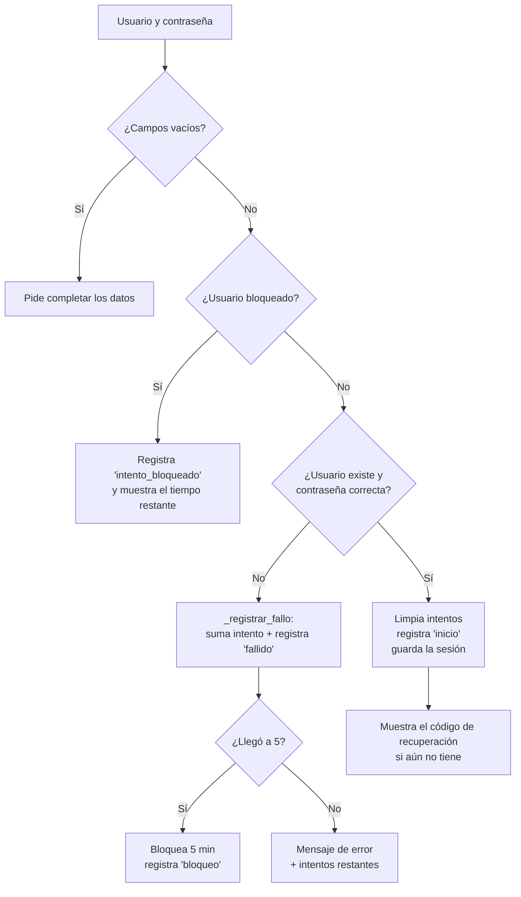

# Guía de seguridad — Tienda Jazmín

Esta guía explica las funciones de seguridad agregadas al sistema:

1. [Cifrado de contraseñas](#1-cifrado-de-contraseñas)
2. [Código de recuperación](#2-código-de-recuperación)
3. [Recuperar la contraseña olvidada](#3-recuperar-la-contraseña-olvidada)
4. [Bloqueo temporal tras 5 intentos fallidos](#4-bloqueo-temporal-tras-5-intentos-fallidos)
5. [Historial de accesos](#5-historial-de-accesos)
6. [Respaldos automáticos cada 2 días](#6-respaldos-automáticos-cada-2-días)
7. [Cambios en la base de datos](#7-cambios-en-la-base-de-datos)
8. [Cómo probarlo paso a paso](#8-cómo-probarlo-paso-a-paso)
9. [Valores que se pueden ajustar](#9-valores-que-se-pueden-ajustar)

Cada sección tiene dos partes:

- **En la interfaz**: lo que ve y hace la persona que usa el programa.
- **En el código**: qué archivos intervienen y cómo funcionan por dentro.

Todo funciona **de forma local**: no se usa internet, correo ni servicios externos.

---

## Mapa de archivos

El proyecto sigue la misma organización de siempre: **modelos** (acceso a la base), **controladores** (reglas y validaciones) e **interfaz** (`ui/`).

| Archivo | Nuevo / modificado | Para qué sirve |
|---|---|---|
| `helpers/seguridad.py` | modificado | Cifrado (hash) de contraseñas y generación de códigos de recuperación |
| `controllers/controlador_login.py` | modificado | Inicio y cierre de sesión, bloqueo, recuperación de contraseña |
| `controllers/controlador_seguridad.py` | **nuevo** | Datos para la sección Seguridad (historial y respaldos) |
| `controllers/controlador_usuarios.py` | modificado | Registra en el historial cada cambio de contraseña |
| `models/acceso.py` | **nuevo** | Tablas `historial_accesos` e `intentos_login` |
| `models/usuario.py` | modificado | Guardar y leer el hash del código de recuperación |
| `database/respaldo.py` | **nuevo** | Crear, listar y limpiar respaldos de la base |
| `database/schema.sql` | modificado | Tablas nuevas |
| `database/conexion.py` | modificado | Migración: columna `codigo_recuperacion_hash` |
| `ui/login_window.py` | modificado | Enlace "¿Olvidaste tu contraseña?" y código en el primer inicio |
| `ui/dialogs/recuperacion_dialog.py` | **nuevo** | Ventanas de recuperación y del código |
| `ui/pages/seguridad.py` | **nuevo** | Pantalla "Seguridad" (solo administrador): contraseñas, respaldos e historial |
| `ui/main_window.py` | modificado | Agrega la sección Seguridad y registra el cierre de sesión |
| `ui/widgets/topbar.py` | modificado | Se quitaron de la barra superior los botones de contraseña y recuperación (ahora están en Seguridad) |
| `ui/app.py` | modificado | Temporizador que revisa los respaldos cada hora |
| `main.py` | modificado | Revisa los respaldos al arrancar |
| `helpers/permisos.py` | modificado | El rol `admin` puede ver la sección `seguridad` |
| `ui/icons.py` | modificado | Íconos nuevos: `key`, `shield`, `folder`, `copy`, `database` |

---

## 1. Cifrado de contraseñas

### En la interfaz

No se ve nada distinto: el usuario escribe su contraseña como siempre. La diferencia está en la base de datos: **la contraseña nunca se guarda tal cual**, sino como un *hash*.

### En el código

Archivo: `helpers/seguridad.py`

Un **hash** es el resultado de pasar la contraseña por una función matemática de un solo sentido. Con el hash no se puede volver a obtener la contraseña. Para saber si una contraseña es correcta, se le aplica la misma función y se comparan los resultados.

```python
ITERACIONES = 260_000

def generar_hash(password):
    sal = secrets.token_hex(16)
    hash_bytes = hashlib.pbkdf2_hmac("sha256", password.encode("utf-8"),
                                     sal.encode("utf-8"), ITERACIONES)
    return f"pbkdf2_sha256${ITERACIONES}${sal}${hash_bytes.hex()}"
```

En la columna `usuarios.password_hash` se guarda un texto con 4 partes separadas por `$`:

```
pbkdf2_sha256 $ 260000 $ 9f2c...e1 $ 4b7a...0d
  algoritmo     vueltas     sal        hash
```

Para qué sirve cada elemento:

- **PBKDF2-SHA256**: algoritmo estándar para contraseñas, incluido en Python (no hace falta instalar nada).
- **Sal (`secrets.token_hex(16)`)**: un valor aleatorio distinto para cada contraseña. Así, dos usuarios con la misma contraseña tienen hashes diferentes, y no sirven las "tablas" de hashes precalculados.
- **260 000 iteraciones**: hacen que calcular cada hash sea lento a propósito. Para un usuario normal no se nota, pero para quien intente adivinar millones de contraseñas se vuelve muy costoso.
- **`hmac.compare_digest`** (en `verificar_password`): compara los hashes en un tiempo constante, para no dar pistas por cuánto tarda la comparación.

`verificar_password(password, hash_guardado)` separa las 4 partes, recalcula el hash con la misma sal e iteraciones y lo compara.

> El mismo mecanismo se usa para guardar los **códigos de recuperación**: en la base solo queda su hash.

---

## 2. Código de recuperación

Como el sistema es local y no envía correos, la forma de recuperar una contraseña es un **código de recuperación**: algo parecido a los "códigos de respaldo" de Google o Microsoft.

> **Solo el administrador tiene código de recuperación.** Las cuentas de ventas no reciben código ni pueden usar "¿Olvidaste tu contraseña?": si olvidan su contraseña, el administrador se la cambia desde **Seguridad → "Cambiar contraseña"**. Esto se controla con `ROLES_CON_RECUPERACION = ("admin",)` en `controllers/controlador_login.py`.

### En la interfaz

**Primer inicio de sesión.** Cuando el administrador entra y todavía no tiene código, antes de abrir la ventana principal aparece la ventana **"Tu código de recuperación"** con:

- El código en letras grandes, por ejemplo `K7QM-3XRA-9TPW`.
- Un botón **"Copiar código"**.
- Un aviso: el código **no se volverá a mostrar** y sirve **una sola vez**.
- El botón **"Ya lo guardé"** para continuar.

**Generar un código nuevo.** Con la sesión iniciada, en la sección **Seguridad**, tarjeta **"Contraseñas y recuperación"**, botón **"Nuevo código"**.

Al pulsarlo:

1. Se pide la **contraseña actual**, por si alguien encontró la sesión abierta.
2. Se muestra el código nuevo. **El anterior deja de funcionar.**

El botón abre la ventana con `MainWindow.nuevo_codigo_recuperacion()` en `ui/main_window.py`, que también comprueba que la sesión sea de administrador.

### En el código

**Generar el código** (`helpers/seguridad.py`):

```python
_ALFABETO_CODIGO = "ABCDEFGHJKMNPQRSTUVWXYZ23456789"

def generar_codigo_recuperacion():
    caracteres = "".join(secrets.choice(_ALFABETO_CODIGO) for _ in range(12))
    return "-".join(caracteres[i:i + 4] for i in range(0, 12, 4))
```

- El alfabeto **no incluye** `0, O, 1, I, L`, que se confunden al copiarlos a mano.
- Se usa `secrets` (aleatoriedad segura) y no `random`.
- Se divide en 3 grupos de 4 para que sea fácil de leer.

**Normalizar** (`normalizar_codigo`): antes de hashear o comparar, se quitan los guiones y espacios y se pasa a mayúsculas. Por eso `k7qm 3xra-9tpw` y `K7QM-3XRA-9TPW` se aceptan igual.

**Guardar** (`models/usuario.py`):

- `guardar_codigo_recuperacion(id_usuario, codigo_normalizado)` guarda el **hash** en `usuarios.codigo_recuperacion_hash`.
- `tiene_codigo_recuperacion(id_usuario)` indica si ya existe uno.
- `obtener_hash_codigo_recuperacion(id_usuario)` lo lee para verificarlo.

**Lógica** (`controllers/controlador_login.py`):

| Función | Cuándo se usa | Qué hace |
|---|---|---|
| `asegurar_codigo_recuperacion()` | Justo después de un inicio de sesión correcto (`ui/login_window.py`) | Si el usuario es administrador y no tiene código, lo crea, lo registra en el historial y lo devuelve para mostrarlo. Si ya tiene, devuelve `None` y no se muestra nada. |
| `regenerar_codigo_recuperacion(password)` | "Nuevo código" en Seguridad (`ui/main_window.py`) | Rechaza a las cuentas de ventas, verifica la contraseña, crea un código nuevo (reemplaza el anterior) y lo registra en el historial. |

**Ventanas** (`ui/dialogs/recuperacion_dialog.py`):

- `CodigoRecuperacionDialog`: muestra el código. Hereda de `FormDialog` (la base de todos los formularios del sistema) y oculta el botón "Cancelar".
- `NuevoCodigoDialog`: pide la contraseña y llama a `regenerar_codigo_recuperacion`.

---

## 3. Recuperar la contraseña olvidada

### En la interfaz

En la ventana de inicio de sesión, debajo de "Iniciar sesión", está el enlace **"¿Olvidaste tu contraseña?"**. Abre la ventana **"Recuperar contraseña"** con 4 campos:

| Campo | Notas |
|---|---|
| Usuario | Se llena solo con lo que se haya escrito en el inicio de sesión |
| Código de recuperación | Con o sin guiones, en mayúsculas o minúsculas |
| Nueva contraseña | Mínimo 6 caracteres |
| Confirmar nueva contraseña | Debe coincidir con la anterior |

Al pulsar **"Guardar contraseña"**:

- **Si algo está mal**, el error aparece en rojo dentro de la misma ventana y se marca el campo con problema (por ejemplo, "La confirmación no coincide…").
- **Si todo está bien**, la contraseña se guarda y aparece de inmediato **un código de recuperación nuevo**, porque el usado ya no sirve. Al cerrarlo, se vuelve al inicio de sesión con el usuario ya escrito, listo para entrar con la nueva contraseña.

Si una cuenta de **ventas** intenta recuperar su contraseña, el sistema lo rechaza con el mismo mensaje que un código incorrecto (*"Usuario o código de recuperación incorrectos. Si tu cuenta es de ventas, pide al administrador que cambie tu contraseña."*). El administrador se la cambia desde **Seguridad → "Cambiar contraseña"**.

### En el código

Función principal: `recuperar_password(nombre_usuario, codigo, password_nueva, confirmacion)` en `controllers/controlador_login.py`.

Devuelve 4 valores: `(exito, mensaje, campo, codigo_nuevo)`. El valor `campo` le dice a la ventana qué entrada marcar en rojo.

Pasos, en orden:

1. **Validaciones básicas**: usuario y código no vacíos, contraseña de al menos 6 caracteres y confirmación igual.
2. **¿Está bloqueado?** Si el usuario está en bloqueo temporal (ver sección 4), se rechaza sin revisar el código.
3. **Verificar el código**: se busca el usuario y se compara el código normalizado con el hash guardado usando `verificar_password`.
4. **Si falla**: cuenta como intento fallido (`_registrar_fallo`). El mensaje es siempre el mismo, **"Usuario o código de recuperación incorrectos."**, para no revelar si el usuario existe.
5. **Si es correcto**:
   - guarda la nueva contraseña (`usuario.actualizar_password`, que la hashea);
   - genera **un código nuevo**, con lo que el anterior queda inválido (un solo uso);
   - reinicia el contador de intentos fallidos;
   - registra el evento `recuperacion` en el historial.

La ventana `RecuperarPasswordDialog` solo recoge los datos y muestra el resultado. Todas las reglas están en el controlador.

---

## 4. Bloqueo temporal tras 5 intentos fallidos

Protege contra **ataques de fuerza bruta**: probar contraseñas una tras otra hasta acertar.

### En la interfaz

- Del 1.er al 2.º intento fallido se muestra: *"Usuario o contraseña incorrectos."*
- En el 3.er y 4.º intento se agrega un aviso: *"Te quedan 2 intentos…"* / *"Te queda 1 intento antes del bloqueo temporal."*
- En el 5.º intento fallido el usuario queda **bloqueado 5 minutos**: *"Por seguridad, este usuario está bloqueado temporalmente por demasiados intentos fallidos. Intenta de nuevo en 5 minutos."*
- Mientras dure el bloqueo, **ni la contraseña correcta funciona**, y el mensaje muestra el tiempo que falta (*"4 min 30 s"*).
- Los intentos fallidos de **recuperación de contraseña** también cuentan: no se puede usar la recuperación para seguir adivinando.
- Cuando pasa el tiempo, el contador vuelve a cero. Un inicio de sesión correcto también lo reinicia.

### En el código

**Tabla `intentos_login`** (`database/schema.sql`):

| Columna | Significado |
|---|---|
| `usuario` | Nombre escrito, **en minúsculas** (clave principal) |
| `intentos` | Intentos fallidos seguidos |
| `bloqueado_hasta` | Fecha y hora en que termina el bloqueo, o `NULL` |

Se lleva por el **texto escrito** y no por el id del usuario, para que:

- `Admin`, `ADMIN` y `admin` compartan el mismo contador;
- también se bloquee un usuario que **no existe**. Si solo se bloquearan los usuarios reales, un atacante podría deducir qué usuarios existen viendo cuáles se bloquean.

**Funciones** (`models/acceso.py`):

- `segundos_de_bloqueo(usuario)`: devuelve cuántos segundos faltan. Si el bloqueo ya venció, borra la fila (reinicia el contador) y devuelve `0`.
- `registrar_intento_fallido(usuario, max_intentos, minutos_bloqueo)`: suma 1 con una sola consulta (*upsert*) y, si llega al máximo, guarda `bloqueado_hasta = ahora + 5 minutos`:
  ```sql
  INSERT INTO intentos_login (usuario, intentos) VALUES (?, 1)
  ON CONFLICT(usuario) DO UPDATE SET intentos = intentos + 1;
  ```
- `limpiar_intentos(usuario)`: borra la fila tras un inicio de sesión o una recuperación correctos.

**Flujo de `iniciar_sesion`** (`controllers/controlador_login.py`):



`_registrar_fallo(...)` se comparte entre el inicio de sesión y la recuperación: así ambos usan las mismas reglas y los mismos mensajes.

Los límites están al inicio de `controlador_login.py`:

```python
MAX_INTENTOS = 5
MINUTOS_BLOQUEO = 5
```

---

## 5. Historial de accesos

### En la interfaz

En el menú lateral del **administrador** hay una sección nueva: **Seguridad** (ícono de escudo). Tiene tres tarjetas, de arriba hacia abajo:

1. **Contraseñas y recuperación**: botones **"Cambiar contraseña"** (la propia o la de una cuenta de ventas) y **"Nuevo código"** de recuperación. Antes estaban en la barra superior. Al terminar cualquiera de los dos, la pantalla se recarga y el evento aparece en el historial.
2. **Respaldos de la base de datos** (ver sección 6).
3. **Historial de accesos**:

- **Tabla** con los últimos 1000 eventos, del más reciente al más antiguo:

  | Columna | Contenido |
  |---|---|
  | Fecha | Día y hora |
  | Usuario | El nombre tal como se escribió |
  | Cuenta | Nombre y rol de la cuenta, o "No existe" si escribieron un usuario inexistente |
  | Evento | Etiqueta de color (ver abajo) |
  | Detalle | Información extra, por ejemplo "Intento 3 de 5" |

- **Lista desplegable de filtro**: Todos, Inicios y cierres, Intentos fallidos, Bloqueos, Contraseñas y recuperación.
- **Buscador**: filtra por cualquier texto (usuario, detalle…).
- **Resumen** al pie: total de eventos, intentos fallidos y bloqueos.

Tipos de eventos:

| Etiqueta en pantalla | Color | Valor en la base | Cuándo ocurre |
|---|---|---|---|
| Inicio de sesión | verde | `inicio` | Entró correctamente |
| Cierre de sesión | gris | `cierre` | "Cerrar sesión" o cerrar la ventana con la X |
| Intento fallido | amarillo | `fallido` | Usuario o contraseña incorrectos |
| Usuario bloqueado | rojo | `bloqueo` | Llegó a 5 intentos fallidos |
| Intento bloqueado | rojo | `intento_bloqueado` | Intentó entrar o recuperar durante el bloqueo |
| Contraseña recuperada | azul | `recuperacion` | Cambió su contraseña con el código |
| Recuperación fallida | amarillo | `recuperacion_fallida` | Código de recuperación incorrecto |
| Código generado | azul | `codigo_generado` | Se creó un código (primer inicio, "Nuevo código" o "Recuperación") |
| Contraseña cambiada | azul | `cambio_password` | El administrador cambió su contraseña o la de una cuenta de ventas (el detalle dice quién la cambió) |

La sección solo existe para el administrador: la cuenta de ventas no la ve en el menú.

### En el código

**Tabla `historial_accesos`** (`database/schema.sql`): `fecha`, `usuario` (texto escrito), `id_usuario` (o `NULL` si no existe), `evento` y `detalle`. Tiene un índice por fecha para ordenar rápido.

**Modelo** (`models/acceso.py`):

- `registrar_evento(usuario, evento, id_usuario=None, detalle=None)`: inserta una fila. Se llama desde `controlador_login.py` en cada caso de la tabla anterior.
- `listar_historial(limite=1000)`: consulta con `LEFT JOIN usuarios` para traer el nombre y el rol de la cuenta (si existe).

**Registro del cierre de sesión** (`ui/main_window.py`). Se hace en `closeEvent`, que se ejecuta tanto con "Cerrar sesión" como al cerrar con la X. Así ningún cierre se queda sin registrar:

```python
def closeEvent(self, evento):
    if sesion.hay_sesion_activa():
        controlador_login.cerrar_sesion()   # registra 'cierre' y limpia la sesión
    ...
```

**Pantalla** (`ui/pages/seguridad.py`):

- `_EVENTOS` asocia cada valor de la base con su texto y color.
- `_FILTROS` define los grupos del filtro. El filtro se aplica con `tabla.set_predicate(...)`, sin volver a consultar la base.
- `refresh()` se llama cada vez que se entra a la sección (como en las demás pantallas), así los datos siempre están al día.
- Los datos llegan por `controlador_seguridad.obtener_historial_accesos()`, que además comprueba que quien pregunta sea administrador.

---

## 6. Respaldos automáticos cada 2 días

### En la interfaz

La segunda tarjeta de la pantalla **Seguridad** es **"Respaldos de la base de datos"**:

| Dato | Ejemplo |
|---|---|
| Último respaldo | 11/10/2026 13:48 |
| Próximo automático | 13/10/2026 13:48 |
| Respaldos guardados | 3 (se conservan los 15 más recientes) |
| Carpeta | `...\database\respaldos` |

Botones:

- **"Crear respaldo ahora"**: hace una copia en ese momento (por ejemplo, antes de un cambio grande).
- **"Abrir carpeta"**: abre la carpeta de respaldos en el Explorador de Windows.

**No hace falta hacer nada para los respaldos automáticos**: el sistema los crea solo.

**Para restaurar un respaldo:**

1. Cerrar el programa.
2. Abrir la carpeta de respaldos y elegir el archivo de la fecha deseada, por ejemplo `tienda_jazmin_2026-10-11_134810.db`.
3. Copiarlo a la carpeta de la base y renombrarlo como `tienda_jazmin.db`, reemplazando el actual. Conviene guardar antes una copia del actual, por si acaso.
4. Volver a abrir el programa.

### En el código

Archivo: `database/respaldo.py`

**Dónde se guardan.** En una carpeta `respaldos` junto a `tienda_jazmin.db`:

- al ejecutar con Python: `database/respaldos/`;
- en el `.exe` compilado: junto al ejecutable.

Cada archivo lleva la fecha en el nombre: `tienda_jazmin_AAAA-MM-DD_HHMMSS.db`. El sistema lee esa fecha del nombre para saber cuándo se hizo el último respaldo, así que no depende de la fecha de modificación del archivo, que OneDrive u otros programas pueden cambiar.

**Cómo se copia** (`crear_respaldo()`):

```python
origen = obtener_conexion()
destino = sqlite3.connect(temporal)      # archivo .tmp
origen.backup(destino)                   # API oficial de backup de SQLite
os.replace(temporal, ruta)               # se renombra solo cuando terminó
```

- Se usa `backup()` de SQLite y no una simple copia de archivo, porque produce una copia **consistente** aunque el programa esté usando la base en ese momento.
- Primero se escribe un `.tmp` y se renombra al final. Si el programa se cierra a la mitad, no queda un respaldo dañado con apariencia de válido.
- Al terminar, `_borrar_antiguos()` elimina los respaldos que pasen de 15, empezando por los más antiguos.

**Cuándo se crea el respaldo automático.** `respaldo_automatico_si_toca()` crea uno si **no hay ninguno** o si el último tiene **2 días o más**. Se llama en dos lugares:

1. **Al abrir el programa** (`main.py`), justo después de preparar la base de datos.
2. **Cada hora mientras el programa está abierto** (`ui/app.py`), con un `QTimer`. Esto cubre el caso de una computadora que se queda varios días con el programa abierto sin reiniciarse.

```python
temporizador = QTimer(app)
temporizador.setInterval(60 * 60 * 1000)   # 1 hora en milisegundos
temporizador.timeout.connect(revisar)
```

Si un respaldo falla (disco lleno, permisos…), el error se imprime en la consola y **el programa sigue funcionando**: un respaldo fallido nunca impide vender.

**Pantalla**: `controlador_seguridad.obtener_estado_respaldos()` reúne la carpeta, la cantidad, el último y el próximo respaldo. `crear_respaldo_manual()` atiende el botón y devuelve `(exito, mensaje)`.

---

## 7. Cambios en la base de datos

No hay que borrar ni recrear la base. Al iniciar, el programa aplica los cambios solo:

| Cambio | Dónde | Cómo se aplica |
|---|---|---|
| Tabla `historial_accesos` | `schema.sql` | `CREATE TABLE IF NOT EXISTS`: se crea si no existe |
| Tabla `intentos_login` | `schema.sql` | Igual |
| Columna `usuarios.codigo_recuperacion_hash` | `conexion.py` → `_aplicar_migraciones` | Revisa con `PRAGMA table_info(usuarios)` y, si falta, hace `ALTER TABLE ... ADD COLUMN` |

Las bases que ya tienen datos (productos, ventas, etc.) **conservan todo**.

---

## 8. Cómo probarlo paso a paso

Se recomienda probar con una copia de la base o con datos de prueba.

**Código de recuperación**

1. Iniciar sesión con `admin`. Debe aparecer "Tu código de recuperación": anotarlo.
2. Cerrar sesión y volver a entrar: esta vez **no** debe aparecer.

**Bloqueo**

3. Escribir `admin` con una contraseña incorrecta 5 veces. En el 3.er y 4.º intento aparece el aviso de intentos restantes; en el 5.º, el bloqueo.
4. Escribir la contraseña correcta: debe seguir bloqueado y mostrar el tiempo restante.
5. Esperar 5 minutos y entrar normalmente.

**Recuperación**

6. Pulsar "¿Olvidaste tu contraseña?", escribir `admin`, el código anotado y una contraseña nueva.
7. Debe aparecer un **código nuevo**: anotarlo. Intentar recuperar otra vez con el código viejo: debe fallar.
8. Entrar con la contraseña nueva.

**Historial y respaldos**

9. Ir a **Seguridad**: en el historial deben verse todos los eventos anteriores. Probar el filtro "Bloqueos".
10. Pulsar "Crear respaldo ahora" y luego "Abrir carpeta": el archivo nuevo debe estar ahí.

---

## 9. Valores que se pueden ajustar

| Qué | Archivo | Variable | Valor actual |
|---|---|---|---|
| Intentos antes del bloqueo | `controllers/controlador_login.py` | `MAX_INTENTOS` | `5` |
| Duración del bloqueo (minutos) | `controllers/controlador_login.py` | `MINUTOS_BLOQUEO` | `5` |
| Días entre respaldos automáticos | `database/respaldo.py` | `DIAS_ENTRE_RESPALDOS` | `2` |
| Respaldos que se conservan | `database/respaldo.py` | `MAX_RESPALDOS` | `15` |
| Cada cuánto se revisa si toca respaldo | `ui/app.py` | `setInterval(...)` en `_programar_respaldos` | 1 hora |
| Iteraciones del hash | `helpers/seguridad.py` | `ITERACIONES` | `260_000` |

> Si se cambia `ITERACIONES`, las contraseñas existentes **siguen funcionando**, porque cada hash guarda el número de iteraciones con que se creó.

> Si se cambia `DIAS_ENTRE_RESPALDOS`, conviene actualizar también el texto "cada 2 días" que aparece en `ui/pages/seguridad.py`.
